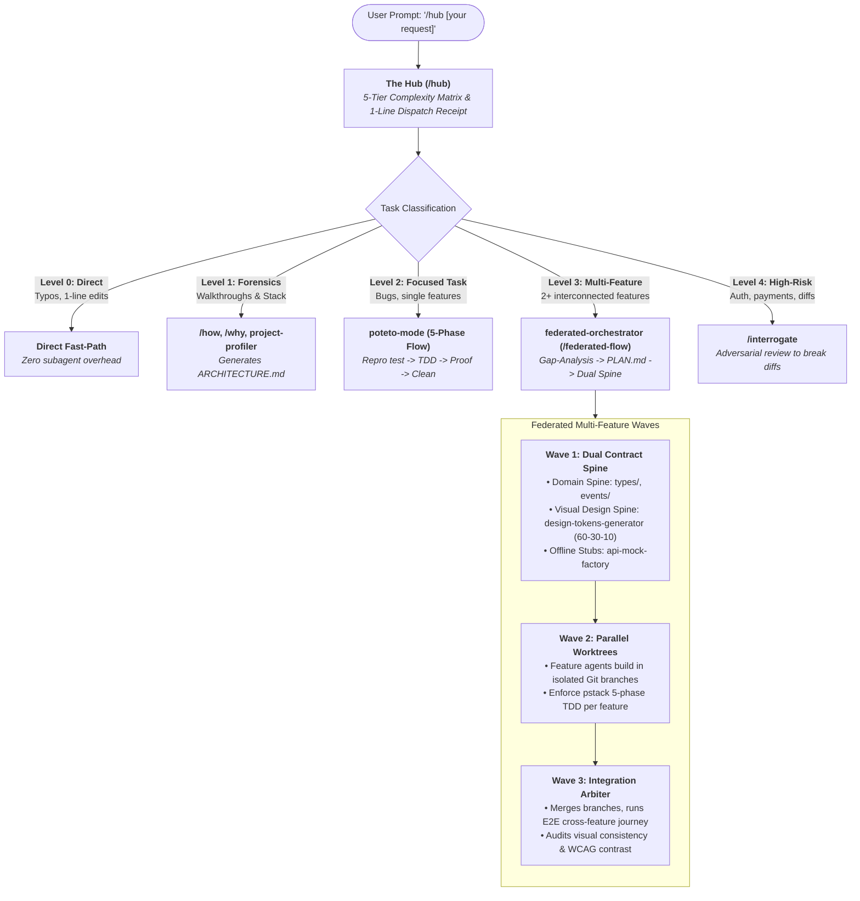

# 🚀 Federated pstack Flow

> An enterprise-grade, multi-agent engineering architecture powered by **pstack** principles and federated multi-feature orchestration.

[](https://opensource.org/licenses/MIT)

---

## 📜 Attribution & Upstream Lineage

This project builds directly upon the foundational engineering principles, playbooks, and verification skills created by **[Lauren Tan (@poteto)](https://github.com/cursor/plugins/tree/main/pstack)** in `pstack`. 

* **Lauren’s `pstack` provides the Tactical Core:** Single-task discipline, root-cause reproduction, TDD, adversarial code review (`/interrogate`), and the 24 `principle-*` constraints.
* **This Project provides the Executive System Layer:** The unified `/hub` meta-router, multi-feature federated worktrees (`/federated-flow`), 60-30-10 UI design tokens, offline mock factories, automated stack profilers, and dev server runners.

---

## 🧠 System Architecture Overview



---

## ✨ Skill Suite

### 1. Executive Multi-Feature Suite
* 🧭 **[`/hub`](.agents/skills/hub/SKILL.md):** The single front door. Analyzes your request and automatically dispatches the optimal skill with a 1-line receipt.
* 🏛️ **[`/federated-flow`](.agents/skills/federated-orchestrator/SKILL.md):** Concurrently plans and builds multiple interdependent features (e.g. *Dashboard + Logistics + Inventory + Messaging*) using isolated Git worktrees and contract-first architecture.
* 🎨 **[`design-tokens-generator`](.agents/skills/design-tokens-generator/SKILL.md):** Generates **60-30-10 color palettes** (60% neutral canvas, 30% structural surface, 10% high-contrast accent for immediate visibility), typography scales, and exports `tokens.ts` + `DESIGN.md`.
* 🔌 **[`api-mock-factory`](.agents/skills/api-mock-factory/SKILL.md):** Generates in-memory service adapters and realistic seed fixtures from TypeScript contracts so feature agents never block waiting for external API keys or live databases.
* 🚀 **[`dev-stack-orchestrator`](.agents/skills/dev-stack-orchestrator/SKILL.md) (`/dev-stack`):** Audits ports and generates startup scripts with graceful `Ctrl+C` trap handlers for backend, frontend, workers, and WebSockets.
* 📄 **[`doc-craft-engine`](.agents/skills/doc-craft-engine/SKILL.md) (`/doc-craft`):** Reverse-engineers reference documents (`.docx`, `.pptx`, `.pdf`) into `DOC_STYLE.json`, then compiles publication-grade Word documents and 16:9 widescreen PowerPoint decks using bundled Python scripts.
* 📋 **[`project-profiler`](.agents/skills/project-profiler/SKILL.md) (`/profile-project`):** Scans any repository and generates an authoritative **`ARCHITECTURE.md`** manifesto so agents immediately know your frontend, backend, database, and daemons without asking.
* 🎭 **[`journey-craft`](.agents/skills/journey-craft/SKILL.md) (`/journey-craft`):** Synthesizes headless Playwright tests, multi-step interactive user flows, and automated WCAG AA/AAA visual contrast verification suites.
* 🚨 **[`incident-triage`](.agents/skills/incident-triage/SKILL.md) (`/incident-triage`):** Forensic analyzer for terminal crashes and stack traces. Isolates culprit lines, pulls git blame, and scaffolds minimal reproduction test stubs.
* 🛫 **[`flight-recorder`](.agents/skills/flight-recorder/SKILL.md) (`/flight-recorder`):** Autonomous release engineer that calculates SemVer impact, risk blast radius (1-5), updates `CHANGELOG.md`, and drafts publication-grade PR markdown.
* 🛡️ **[`env-sentinel`](.agents/skills/env-sentinel/SKILL.md) (`/env-sentinel`):** Detects missing environment keys, orphaned configs, and secret leaks across code and `.env` files with auto-synchronization to `.env.example`.
* 🔒 **[`app-shield`](.agents/skills/app-shield/SKILL.md) (`/app-shield`):** Post-prototype security hardening & UX resilience engine. Audits XSS, CSRF, security headers, open CORS, and scaffolds custom 404/500 error boundaries.
* 🧠 **[`til-vault`](.agents/skills/til-vault/SKILL.md) (`/til-vault`):** Persistent memory vault and Architecture Decision Record (ADR) manager so agents never repeat past mistakes or fight known tooling quirks.

### 2. Tactical Engineering Core (from Lauren Tan's `pstack`)
* ⚡ **`poteto-mode`:** Flagship router with 23 playbooks enforcing root-cause investigation before code changes.
* 📐 **`/architect`:** Settles types, contracts, and module boundaries before logic is written.
* 🧪 **`/tdd`:** Strict test-driven development: write the failing reproduction test first, then the minimal fix.
* 🥊 **`/arena`:** Spawns multiple parallel agent candidates on the same task, benchmarks them, and grafts the best elements together.
* 🐝 **`/swarm`:** Parallel worker fan-out across independent packages or file slices.
* 🕵️ **`/interrogate`:** Adversarial code review hunting for race conditions, memory leaks, and unhandled edge cases.
* 🔍 **`/how` & `/why`:** Subsystem architectural walkthroughs and historical git archaeology.
* 🧹 **`/unslop` & `/no-comments`:** Strips AI conversational tells and debug commentary before review.
* 📜 **The 24 `principle-*` Skills:** `prove-it-works`, `fix-root-causes`, `laziness-protocol`, `subtract-before-you-add`, `model-the-domain`, `boundary-discipline`, `guard-the-context-window`, etc.

---

## ⚡ Quickstart

### 1. Installation
Copy `.agents/skills` to your project or global agent directory:
```bash
# Unix (macOS / Linux / WSL)
cp -r .agents/skills/* ~/.agents/skills/

# Windows (PowerShell)
Copy-Item -Recurse -Force .agents/skills/* $HOME/.agents/skills/
```

### 2. Usage Examples

* **Single Task / Bug Fix:**
  ```text
  /hub the checkout button triggers duplicate charges on double-click. repro first, then fix and verify.
  ```
* **Multi-Feature System Epic:**
  ```text
  /hub add dashboard, inventory, logistics tracking, and messaging to this app.
  ```
* **Map Existing Project Stack:**
  ```text
  /hub audit this repository and declare our architecture manifesto
  ```
* **Start Local Dev Stack:**
  ```text
  /hub start our local backend, frontend, worker, and websocket servers
  ```

---

## 📄 License

This project is licensed under the **MIT License**.  
Contains upstream code and principles Copyright (c) 2024-2026 Lauren Tan (`@poteto`).  
Executive multi-feature extensions Copyright (c) 2026.
